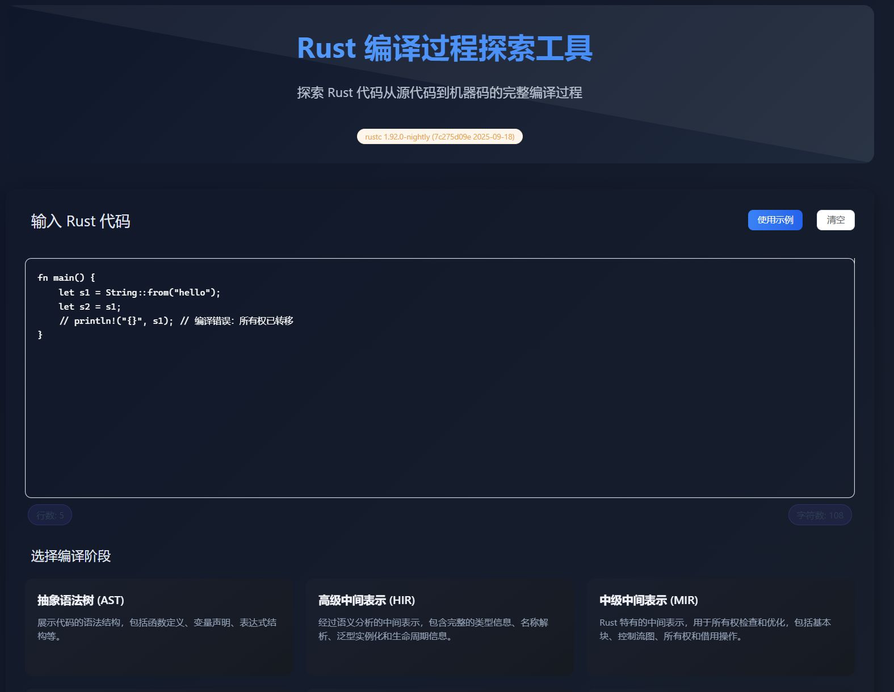
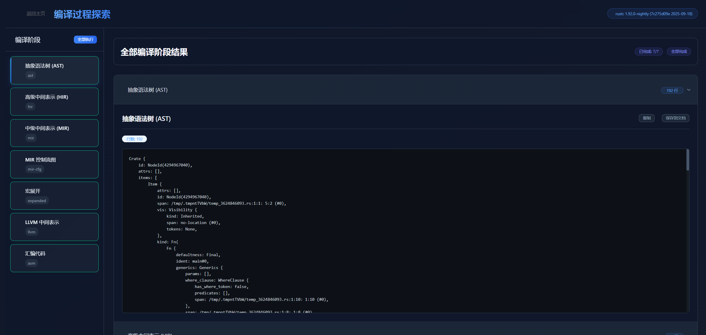

# Rust 编译过程探索工具

一个交互式 Web 应用程序，用于可视化探索 Rust 代码的完整编译过程。从源代码到机器码，深入了解 Rust 编译器的每个阶段。

## 功能特性

- **实时编译探索**：输入 Rust 代码，实时查看不同编译阶段的结果
- **多种编译阶段**：支持 AST、HIR、MIR、MIR CFG、宏展开、LLVM IR、汇编代码
- **批量处理**：一次性探索所有编译阶段，对比不同阶段的输出
- **现代化界面**：深色主题，代码高亮，响应式设计
- **便捷操作**：一键复制、下载、导出编译结果

## 快速开始

### 环境要求
- Rust nightly 工具链
- Node.js 18+（Vite 6 要求；本机实测 v24）

### 安装步骤

```bash
# 1. 克隆项目
git clone <repository-url>
cd rust-compile-web

# 2. 启动后端服务
cd backend
rustup override set nightly
cargo run

# 3. 启动前端服务（新终端）
cd ../frontend
npm install
npm run dev
```


## 使用方法

### 主页界面
1. **输入 Rust 代码**：在代码编辑器中输入或粘贴 Rust 代码
2. **选择编译阶段**：从七个编译阶段中选择一个或探索全部
3. **开始探索**：点击"开始探索"按钮查看编译结果





### 编译阶段说明
- **AST**：抽象语法树，展示代码的语法结构
- **HIR**：高级中间表示，包含类型信息和语义分析
- **MIR**：中级中间表示，用于所有权检查和优化
- **MIR CFG**：MIR 控制流图，展示程序流程
- **Expanded**：宏展开后的完整代码
- **LLVM IR**：LLVM 中间表示
- **Assembly**：最终的汇编代码

## 项目结构

```
rust-compile-web/
├── backend/          # Rust 后端服务
├── frontend/         # Vue3 前端应用
```


访问应用：
- 前端界面: http://localhost:5175（`frontend/vite.config.js` 里 `server.port = 5175`，`strictPort`）
- 后端 API: http://localhost:8080（自己 `cargo run` 时的默认端口）

> 端口说明：后端默认 `8080`（`backend/src/main.rs`，可用 `PORT` 覆盖）；`ProjectAccess` 为避免与 WestChina 网关的 8080 冲突，启动时传 `PORT=18080` 并给前端注入 `VITE_PROXY_TARGET=http://127.0.0.1:18080`。手动开发就按上面的 8080 + 默认代理即可。

## 部署到 Vercel

前端可像 `cPlusBook` 一样部署到 Vercel；**后端需单独部署**（需 nightly rustc，Vercel 无法运行）。

详见 **[DEPLOY.md](./DEPLOY.md)**。

快速步骤：

1. Vercel 导入仓库，Root Directory 指向本项目
2. 使用仓库内 `vercel.json` + `build.sh`（已配置）
3. 将 `backend/` 部署到 Railway / Fly.io（见 `backend/Dockerfile`）
4. 在 Vercel 设置环境变量 `VITE_API_BASE_URL=https://你的后端/api`
5. Redeploy 前端
